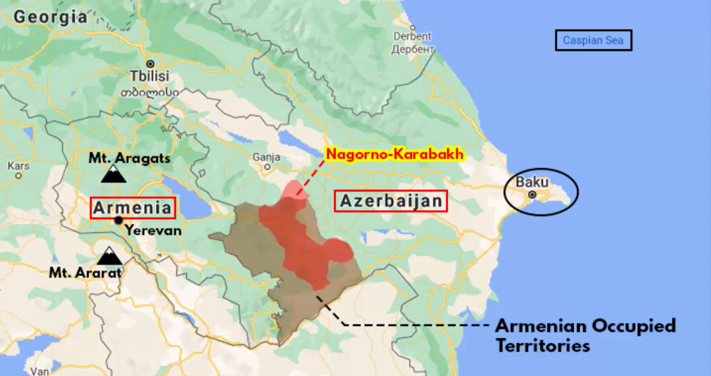

# $\fbox{MODERN WARS}$

## **Topic - 1: Russia-Ukraine War**

### <u>Key Information</u>

- Started on *Feb 24th, 2022*
- Largest invasion in *Europe* since WW2.

### <u>History</u>

- *Niper* river and its associated kingdom is common dispute between both.
- Mongols invaded same kingdom & destroyed it, becoming their common enemy.
- Under USSR, *Ukrainian* was treated as a regional dialect of Soviet.
- Stalin's policies killed $\approx 44$ million people in famine.

### <u>Modern Frictions</u>

- Putin believes that *Russia*, *Ukraine*, and *Belarus* being part of same nation.
- Ukraine developed nuclear warheads but were given up as gesture of peace with Russia.
- Russia promised not to use military power against Ukraine through *Budapest memorandum* (not a treaty).
- Russia's theory about Ukraine not being a separate nation was declined by USA, France, and Germany.
- Russia grew hostile when many nations started joining NATO.

>**<u>NOTE</u>:**
>NATO (*North Atlantic Treaty Organization*) was never signed as a legal treaty.

### <u>The War</u>

- President of Ukraine during 2014 was *Viktor Yanukovych*.
- Yanukovych was about to sign *association agreement* with EU for trades, but under pressure of Russia it suspended it, signing the pact with Russia instead.
- Ukrainian citizens protested against it, and some were killed from sniper shootings. Then Viktor fled Ukraine.
- Seeing the hierarchical gap, *Crimea* was annexed on 2014.
- Russia sent $190,000$ soldiers for an initial plan to capture Ukraine in 10 days.
- Sooner, it just became a war of attrition between both.
- By September 2026, about $43,000$ Ukrainian soldiers, and $10,000$ Ukrainian citizens have been killed.

## **Topic - 2: Armenia-Azerbaijan Conflict**

### <u>Armenia</u>

- *Armenia* is located on the left of *Azerbaijan*.
- Capital is *Yerevan*, lying between two volcanoes - *Mt. Aragats* & *Mt. Ararat* (in *Turkey*).
- $97\%$ Christians but with constitution that guarantees freedom of religion.
- Homogeneous society which includes *Armenian Christians*, *Russian Orthodox Christians*, *Islam*, *Judaism*, etc.

### <u>Azerbaijan</u>

- *Azerbaijan* is located on the left side of the *Caspian Sea*.
- Capital is *Baku*, facing the *Caspian Sea*.
- $94\%$ Muslims ($85\%$ *Shia* & $15\%$ *Sunni*) but also with freedom of religion in constitution.
- Also homogeneous with *Russian Orthodox Christians*, *Armenian Orthodox Christians*, *Judaism*, *Hinduism*, etc.

### <u>Conflict</u>

- Region of conflict is *Nogorno-Karabakh*, dominated by Armenian population.
- *Azerbaijan* claims it as its own territory, but it is actually under *Armenian* separatists since 1992 War.
- In 1992 War, more than $30K$ were killed and $1M$ were displaced, ceasefire brokered by *Russia*.
- The modern war started after some locals were killed in region of conflict, with no clarity on how it started and both countries blaming each other.
- This war is getting attention because of involving *Turkey* & *Russia* which have fought with each other multiple times for centuries.

### <u>Alliance</u>

- *Russia* supplies both the nations with military goods, but it sided with Armenia subtly through supplying weapons.
- *Turkey* supported *Azerbaijan* being an Islamic nation.
- Russia has signed *CSTO* (Collective Security Treaty Organization) with former *Soviet* block nations.

### <u>Effect On Economy</u>

- *Azerbaijan* has many gas pipelines that start from *Caspian Sea* and pass to nations across *Black Sea* & *Mediterranean Sea*.
- For example - *Italy*, *Turkey*, *Russia*, etc.
- *Turkey* comes between these consumer and supplier nations.

---
