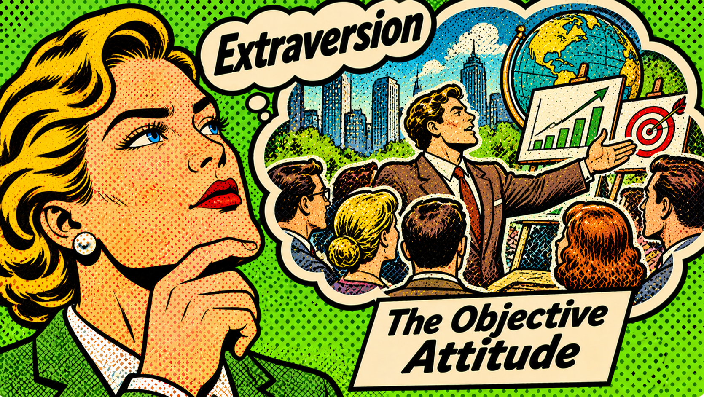
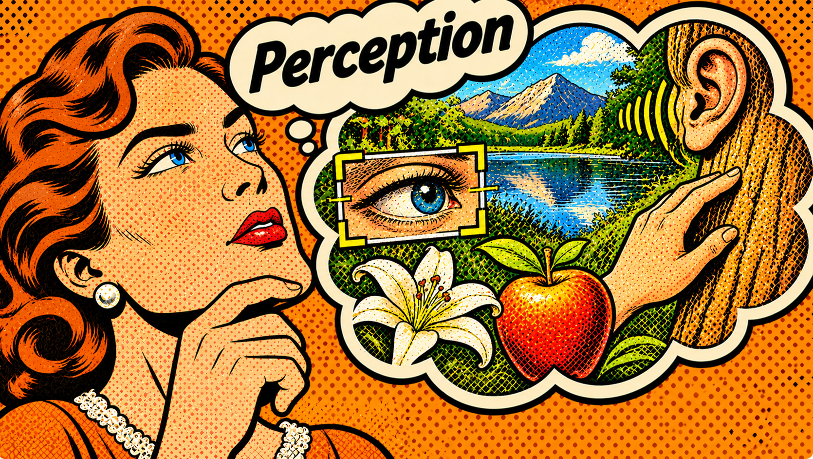
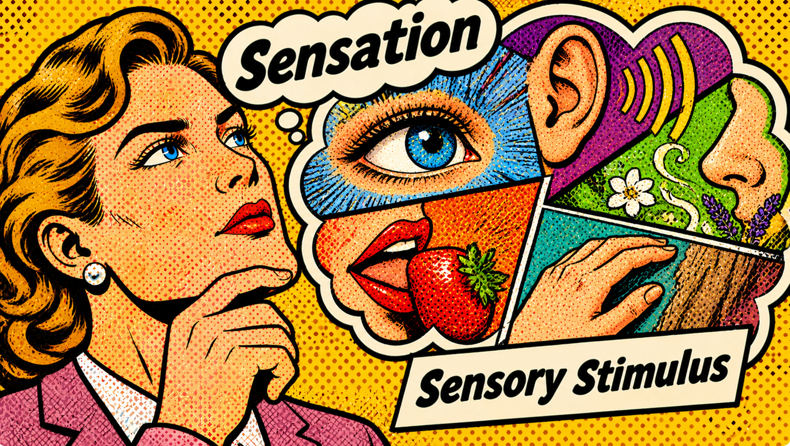
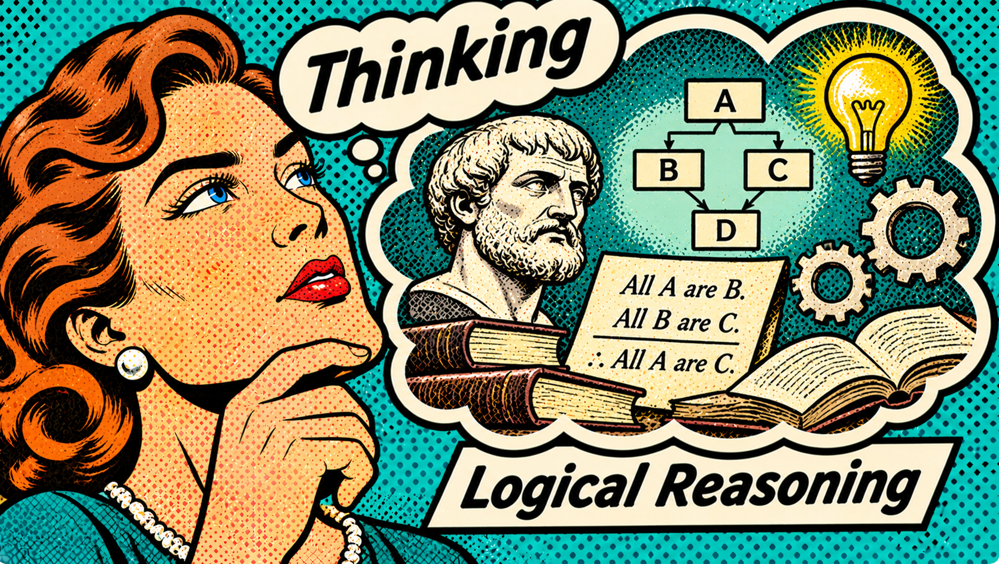

# $\fbox{AXIOSEMATICS}$

Founder & Owner
[Typology Atlas](https://typologyatlas.com),
typologyatlas@gmail.com

## 1. Abstract

**Axiosematics** is a proposed psychological typology framework developed by Typology Atlas, designed to explain individual differences in information processing through a structured system of cognitive primitives, functions, attitudes, and cognitive elements. Drawing primarily from Carl Jung's theory of psychological types, it seeks to provide a more explicit account of how individuals orient themselves towards information, perceive it, and subject it to judgment.

The framework establishes two fundamental attitudes: **Introversion**, characterized by the predominance of the subjective factor, and **Extraversion**, characterized by the predominance of the objective factor. It further distinguishes between two categories of information processing: **Perceiving functions**, which apprehend information without subjecting it to judgmental operations, and **Judging functions**, which process information through organization, evaluation, and comparison. These categories comprise four fundamental functions: Sensation, Intuition, Thinking, and Feeling.

Combining the two attitudes with the four functions produces eight cognitive elements: Photographic Sensation (Se), Associative Sensation (Si), Resource Potential (Ne), Symbolic Potential (Ni), Evidential Logic (Te), Axiomatic Logic (Ti), Collective Values (Fe), and Personal Values (Fi). These elements describe distinct orientations towards sensory stimuli, hidden potential, logical reasoning, and values.

Beyond the fundamental cognitive elements, Axiosematics introduces three cognitive factors which are awareness, importance, and engagement—to describe how each element operates within an individual's psychological configuration. Their combinations form an eight-element architecture consisting of Character, Hobby, Ghost, Instinct, Threat, Distraction, Avoidance, and Resistance elements. This architecture produces sixteen distinct personality configurations.

Axiosematics ultimately aims to offer a coherent and systematic model for understanding psychological orientation and information processing, while retaining a conceptual connection to Jungian typology and introducing its own theoretical extensions. It remains a proposed theoretical model rather than an empirically validated psychological assessment system.

## 2. Basic Terminologies

### 2.1 <u>Subjective Baseline</u>:

- **Consciousness:** Ability to have a default computational mode.
- **Ego:** Ability to differentiate between subject and object.
- **Content:** Information that comes into attention of consciousness.

### 2.2 <u>Sources Of Information</u>:

- **Subject:** A system made by combining consciousness and ego.
- **Object:** Everything other the subject.

### 2.3 <u>Primitives Types</u>:

- **Attitude:** Mode of alignment to information that the object possesses, where one is dominant and the other periodically compensates for overusing it along with archaic function.
- **Function:** A form of information that the system possesses.
- **Cognitive element:** The effect produced by combination of dominant attitude and primary function.
- **Type:** The complete personality produced after combining the attitude, primary function, and secondary function.

### 2.4 <u>Cognitive Factors</u>:

- **Awareness factor:** Tells if a function is used *consciously* (deliberately) or *unconsciously* (unknowingly).
- **Differentiation factor:** Tells if a subject assimilates processes of a function to another.

## 3. Constraints On Primitives

### 3.1 <u>List Of Primitives</u>:

- Introversion ($I$)
- Extroversion ($E$)
- Sensing ($S$)
- Intuition ($N$)
- Thinking ($T$)
- Feeling ($F$)

### 3.2 <u>Axioms To Satisfy</u>:

1. Its all about default information computation mode.
2. Its not about end goal, or skills to perform preferred action. 
3. It can exist without prior experience, or any kind of resources. 
4. It can exist under any form of immediate surrounding or condition. 
5. Level of intelligence doesn't affect which mode is there by default. 
6. One primitive can not reproduce another in any form. 

## 4. Attitude

### 4.1 <u>Introversion (I)</u>:

Also known as *subjective attitude*, is a mode of leaning where the subjective factor is given more importance than the objective factor. This subjective factor is associated with subject's subjective processing. So, it is concerned more with the internal compass of subject as it strongly feels. The attention is concentrated more towards how the subject associates its inner compass with the object than the object or objects themselves.

For example, someone might notice a tree and concentrate on how it reminds him/her of his/her childhood memories. Noticed that? There is an inner compass that redirects them to associate the tree which is associated more with where the subject's inner compass redirects it to than the object itself.

### 4.2 <u>Extraversion (E)</u>:

Also known as *objective attitude*, is a mode of leaning where the objective factor is given more importance than the subjective factor. This objective factor is associated with what the object itself presents under consciousness. So, it is concerned more with the actuality of the object as it represents. The attention is concentrated more towards the object itself than how the subject associates its inner compass with the object.

For example, someone might notice the same tree and concentrate on its exact shape, color, and texture as he or she is seeing. In contrast to previous example, the subject gazes its attention on the object and its qualities, with less influence from the subject's inner compass.

## 5. Function Types

### 5.1 <u>Perceiving Function (p)</u>:

Functions which supplies the information gained through object without being subjected to any operation. For example, at a dockyard someone might simply notice the ships anchored and temperature around the coast. It simply observes what it is without organizing these information. *Sensation* and *intuition* are perceiving functions.

### 5.2 <u>Judging Function (j)</u>:

Functions which subjects supplied information to operations like organization, evaluation, and comparison as per some criterion. For example, at same dockyard someone might count the number of ships anchored and calculate of how much oil they must be consuming. Here, the data supplied in being processed. *Thinking* and *feeling* are judging functions.

## 6. Functions

### 6.1 <u>Sensation (S)</u>:

*Sensation* is a perceiving function which is concerned with the sensory stimulus transmitted by the object through the five senses. It is a form of direct perception where the object's sensory qualities are brought into attention, contrary to hidden potential. For example, in a room, sensing will focus on information like the color of the wall or shape of flower pot.

### 6.2 <u>Intuition (N)</u>:

*Intuition* is a perceiving function which is concerned with the hidden potential in an object. It is a form of indirect perception where the hidden potential into attention, contrary to raw sensation. For example, in the same room, intuition will focus on information about hidden potential, like alternative use case of the flower pot that might be unconventional.

### 6.3 <u>Thinking (T)</u>:

*Thinking* is a judging function which is concerned with judging objects through logical reasoning and conceptual relations, contrary to values. For example, a person takes a career decision by evaluating how good it is in terms of salary, reviews, and working hours. This is evaluation with logic where criterion is based on something with a conceptual relation.

### 6.4 <u>Feeling (F)</u>:

*Feeling* is a judging function which is concerned with judging through values, contrary to logical reasoning and conceptual relations. For example, a person takes a career decision by evaluating how moral it is and how its mission to a greater good. This evaluation with values where criterion is based on something rooted in some form of preference, which is not logical.

## 7. Cognitive Elements

### 7.1 <u>Introverted Sensing (Si)</u>:

*Introverted sensing* which is also known as *associative sensation* combines *introverted* attitude and function of *sensation* to produce a *subjective* attitude towards *sensory stimulus*. Using this, a subject receives the sensory stimulus from an object, but instead of being focused on the literal sensation it transmits, they associate it with what sensation their inner compass redirects them to.

For example, someone smears a drop of watercolor on his finger and it reminds him of the texture of oil he used to apply to his younger sister's hair in childhood. This shows a sensory association which was triggered from the object's sensation, but was ultimately handled by an inner compass of sensation.

### 7.2 <u>Extraverted Sensing (Se)</u>:

*Extraverted sensing* which is also known as *photographic sensation* combines *extraverted* attitude and function of *sensation* to produce an *objective* attitude towards *sensory stimulus*. Using this, a subject remains largely concentrated on the raw sensory stimulus received from an object, without being affected by the subjective association it triggers within them.

For example, someone visits a popular beach spot for vacation, and when their friend later asks them about how it was, they describe the exact sensory properties of the beach. Like the water was transparent, sky was bluish, and sun was bright. This shows a leaning towards sensation as objectively perceived.

### 7.3 <u>Introverted Intuition (Ni)</u>:

*Introverted intuition* which is also known as *symbolic potential* combines *introverted* attitude and function of *intuition* to produce a *subjective* attitude towards *hidden potential*. Using this, a subject perceives hidden potential in objects based on what their inner compass shows them, and not the potential that object itself contains as subjective contents influence it.

For example, someone comes to know that their friend won the marathon just before their brother's birthday, and later treating it as a divine message to them saying they must cheer up. Notice that the potential hidden in object itself wasn't given importance, but it was given to subject's own understanding or inner direction which influenced their perception.

### 7.4 <u>Extraverted Intuition (Ne)</u>:

*Extraverted intuition* which is also known as *resource potential* combines *extraverted* attitude and function of *intuition* to produce an *objective* attitude towards *hidden potential*. Using this, a subject perceives hidden potential in object itself instead of letting their subjective influence (inner compass) affect their perception, thus being concentrated on objective information.

For example, someone notices a bunch of discarded broken mechanical parts in a storeroom, and then perceives their collective potential to form a windmill, or even each part's individual potential to be a very critical part in expensive machineries. Notice how the potential is seen in object, and not symbolic for being affected by subject's experiences. Resource can also be living entity.

### 7.5 <u>Introverted Thinking (Ti)</u>:

*Introverted thinking* which is also known as *axiomatic logic* combines *introverted* attitude and function of *thinking* to produce a *subjective* attitude towards *logical reasoning*. Using this, a subject judges an object through an inner compass of logic which is established through some established principles or axioms, and the object is tested against those premises.

For example, someone comes to know that evidences against criminal were found but he feels something is wrong because the conclusion doesn't follow from established evidences, as deduction proves it wrong. This is a case where subject feels something is wrong because its own assumptions were challenged, making such people sometimes precise yet cynical in nature.

### 7.6 <u>Extraverted Thinking (Te)</u>:

*Extraverted thinking* which is also known as *evidential logic* combines *extraverted* attitude and function of *thinking* to produce an *objective* attitude towards *logical reasoning*. Using this, a subject judges an object through objective evidences which are established, instead of verifying it against subject's established principles.

For example, someone makes an experiment by mixing two chemical compounds and finds the color of resulting compound to be bluish. But because it has been objectively established that it happened, she won't check against the established premises which the inner compass would have detected as something wrong for not following deductively.

### 7.7 <u>Introverted Feeling (Fi)</u>:

*Introverted feeling* which is also known as *personal values* combines *introverted* attitude and function of *feeling* to produce a *subjective* attitude towards *values*. Using this, a subject judges an object through an inner sense of values directed by inner compass, instead of adapting to the values of other entities around the subject to judge the object.

For example, someone sees an adult misbehaving with a child in a public gathering, and then approaches the adult to berate him for doing so because her values go against doing so. This was a particular case where *Fi* is used, not necessarily that the subject here was primarily *Fi* user. Notice that the case was more about values over reasoning.

### 7.8 <u>Extraverted Feeling (Fe)</u>:

*Extraverted feeling* which is also known as *collective values* combines *extraverted* attitude and function of *feeling* to produce a *objective* attitude towards *values*. Using this, a subject judges an object through the values possessed by the objective environment, instead of being guided by inner compass to realize their own. This often makes them socially very adaptable.

For example, someone witnesses a conflict between two people which is the object (the situation) in workspace, and they have to decide which of the two options he must take. So he will take this decision as per which side adheres to the collective values of the workspace. The fact about whether these values are established as a framework or not doesn't make it logical.

## 8. Function Stack

### 8.1 <u>Primary Function (f1)</u>:

*Primary function* is the most differentiated & most conscious function. Meaning the subject is well aware about using this function when they using it, i.e. *highly conscious*. And also this function takes the lead above all other functions, and also differentiates well the difference between itself and the *archaic* function, i.e. *high differentiation*. The subject often mistakes the operations of the *archaic* function as being performed because of the *primary function*.

### 8.2 <u>Secondary Function (f2)</u>:

*Secondary function* is a moderately differentiated & moderately conscious function. Meaning the subject is somewhat aware about using this function being subject to particular situation, i.e. *moderately conscious*. And this function supports the *primary function* to manage its operation into a manifestation that is meaningful, with a moderate differentiation from its opposing function, i.e. *moderate differentiation*. If *primary function* is perceiving type, it is judging, and vice-versa.

### 8.3 <u>Archaic Function (f3)</u>:

*Archaic function* is a less differentiated & mostly a unconscious function. Meaning the subject is not much aware when about using this function when it does so, i.e. *lowly conscious*. And this function often comes up abruptly to compensate for the overused *primary function* along with opposing attitude, with very less differentiation from the *primary function*, i.e. *low differentiation*. Subject mistakes its usage to be attributed to *primary function*. It has the same nature as *primary function* (perceiving or judging).

## 9. Notations

### 9.1 <u>Meaning For Symbols</u>:

- $I$ stands for *Introversion*
- $E$ stands for *Extraversion*
- $S$ stands for *Sensation*
- $P$ (Potential) stands for *Intuition*
- $L$ (Logic) stands for *Thinking*
- $V$ (Values) stands for *Feeling*

### 9.2 <u>Type Formation Rules</u>:

1. The dominant attitude of a type is written as first letter. For example, dominant attitude $I$ would mean notation is $I\_\_$.
2. Then second letter is the *primary function*. For example, primary function $L$ ($T$) would mean notation is now $IL\_$.
3. And finally the third letter is the *secondary function*. For example, depending on whether its $S$ or $P$ ($N$), type would be represented as $ILS$ or $ILP$.

### 9.3 <u>Personality Types</u>:

| Type  | Nickname       | Main Attitude | f1  | f2  | f3  |
| :---- | :------------- | :-----------: | :-: | :-: | :-: |
| $ISL$ | Formulator     |      $I$      | $S$ | $T$ | $N$ |
| $ISV$ | Memorist       |      $I$      | $S$ | $F$ | $N$ |
| $ESL$ | Explorer       |      $E$      | $S$ | $T$ | $N$ |
| $ESV$ | Aesthetician   |      $E$      | $S$ | $F$ | $N$ |
| $IPL$ | Visionary      |      $I$      | $N$ | $T$ | $S$ |
| $IPV$ | Humanist       |      $I$      | $N$ | $F$ | $S$ |
| $EPL$ | Forecaster     |      $E$      | $N$ | $T$ | $S$ |
| $EPV$ | Enthusiast     |      $E$      | $N$ | $F$ | $S$ |
| $ILS$ | Solipsist      |      $I$      | $T$ | $S$ | $F$ |
| $ILP$ | Analyst        |      $I$      | $T$ | $N$ | $F$ |
| $ELS$ | Empiricist     |      $E$      | $T$ | $S$ | $F$ |
| $ELP$ | Presenter      |      $E$      | $T$ | $N$ | $F$ |
| $IVS$ | Crusader       |      $I$      | $F$ | $S$ | $T$ |
| $IVP$ | Romantic       |      $I$      | $F$ | $N$ | $T$ |
| $EVS$ | Traditionalist |      $E$      | $F$ | $S$ | $T$ |
| $EVP$ | Connector      |      $E$      | $F$ | $N$ | $T$ |

## 10. Myth Busters

#### i) How is efficiency related to Te?

Efficiency is not exclusive to Te, as it could come up from usage of different functions. For example, a Ti might take axiomatic approach to increase efficiency while Te might use existing evidences to organize such systems.

#### ii) Is Function Stack inspired from Jung's theory?

Partially. The arrangement as per level of awareness to the subject (conscious or unconscious) is directly inspired by Jung's description of how functions are differentiated in psyche, while factor of importance was taken from Socionics after evaluation.

#### iii) Why Ti looks for consistency?

Consistency is not exclusive to Ti. It depends on what causes them to care for consistency. Because Ti judges from axioms and base principles, they might reject a working system for inconsistency. But same applies to Te when their evidence rejects previous records as Jung explains about Darwin in *Psychological Types*.

#### iv) Is Fi spontaneous unlike Ti?

Its not an universal truth. People often believe that Ti have 'written set of rules to follow', but it depends on whether the context is logical or based on values. Just making a coherent framework of values doesn't mean orientation towards Ti.

#### v) Why are Se physically reactive?

While physical combat skills or reactiveness depends on individual conditioning, Se could come up as more reactive to environment because of their intense perception of photographic sensation, i.e. high concentration on the objective factor of sensation.

#### vi) Can people having different types arrive at same conclusion?

Ofcourse! And even people with same type arrive at different conclusion. Types have elements in them, which decide their level of awareness, importance given, and intensity of engagement. And elements tell the orientation of the subject. Conclusion is not fully dependent on that.

#### vii) How does Ni simulates time?

There is no guarantee that Ni will only simulate time, and that other functions can't do that. There can be different approaches to do so. For example, Ne perceives what unfolds while sticking to object's own potential. Or Te uses established formulae to predict time, though it would be judgment and not perception. Similarly Ni might use symbols as means to guide them through time.

#### viii) Is it a good way to type from nicknames?

No. Nicknames are just shorthand given to each type for easy pronounce, but using them for typing dismisses the complicated architecture of types. And thus there are chances for attenuation.

#### ix) How to type people?

While there can be different ways, best is to make tally of different behavioral characteristics of people or fictional characters for their level of consciousness and differentiation separately - for each function. And finally reach the closest type as per that.

#### x) Is Axiosematics compatible with MBTI?

No. Reason is not simply mismatch, but due to their macro primitives and black-box approach to explaining functioning. Same with Socionics. *Axiosematics* tries to come closest to original Jungian theory, while trying to simplify certain concepts while keeping coherent architecture and minor modifications for better explanations.

#### xi) Can I diagnose myself with Axiosematics?

Not recommended. It is advised to reach out a certified psychologist for mental diagnosis, or a therapist. Model is estimated model and not a definite architecture backed by empirical studies.

## 11. License

Licensed under Creative Commons Attribution 4.0 International (CC BY 4.0)
https://creativecommons.org/licenses/by/4.0/

---
