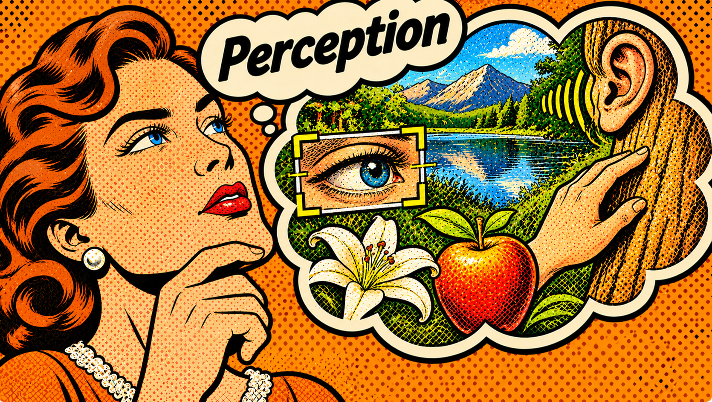
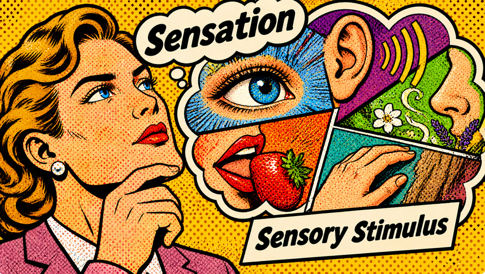
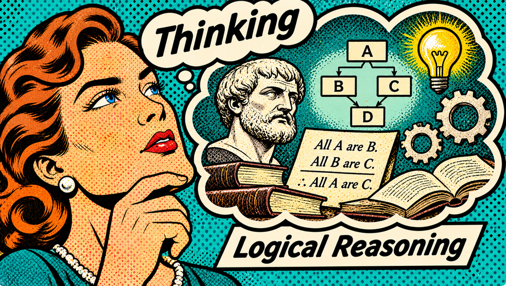

# $\fbox{REFERENCICS}$

Gourav Kumar Mallick,
Parul University (Student),
12b.39gourav@gmail.com

## 1. Abstract

The **Honeycomb Computational Cognition Model (HCC)** is a typological framework for describing differences in the default computation of information by a subject. It distinguishes two attitudes, *Introversion* and *Extroversion*, describing *decompositional* and *compositional* processing, respectively, from four information elements: *Sensing*, *Intuition*, *Thinking*, and *Feeling*. These six primitives combine into functions representing distinct modes of processing particular forms of information.

HCC is constrained by axioms intended to distinguish default computational mode from goals, abilities, prior experience, resources, environmental conditions, and intelligence. Functions may interact through a hierarchical architecture of primary, secondary, tertiary, and quaternary function sets, allowing alternative computational modes to become accessible when processing encounters obstacles or requires different information. From this architecture, HCC derives sixteen typological configurations represented through its own notation.

The model is intended as a computationally oriented extension within the broader Jungian family of typological theories. It describes patterns of information processing rather than psychological health, mental disorders, or clinical conditions, and is not intended as a diagnostic instrument.

## 2. Basic Terminologies

### 2.1 <u>Subjective Baseline</u>:

- **Consciousness:** Ability to have a default computational mode.
- **Ego:** Ability to differentiate between subject and object.
- **Content:** Information that comes into attention of consciousness.

### 2.2 <u>Sources Of Information</u>:

- **Subject:** A processing function made by combining consciousness and ego.
- **Object:** Everything other the subject.

### 2.3 <u>Primitives Types</u>:

- **Information elements ($S$, $N$, $T$, $F$):** A form of information that the system possesses.
- **Attitude ($I$, $E$):** Mode of alignment to information that the object possesses.

### 2.4 <u>Function Types</u>:

- **Default functions (lens/support/blindspot/repressed):** Functions which are by default operated by the individual, without deliberate effort or force.
- **Effortful functions (ability/standby/avoided/suppressed):** Functions which can be operated only with deliberate effort and manually.

## 3. Constraints On Primitives

### 3.1 <u>List Of Primitives</u>:

- Introversion ($I$)
- Extroversion ($E$)
- Sensing ($S$)
- Intuition ($N$)
- Thinking ($T$)
- Feeling ($F$)

### 3.2 <u>Axioms To Satisfy</u>:

1. Its all about default information computation mode.
2. Its not about end goal, or skills to perform preferred action. 
3. It can exist without prior experience, or any kind of resources. 
4. It can exist under any form of immediate surrounding or condition. 
5. Level of intelligence doesn't affect which mode is there by default. 
6. One primitive can not reproduce another in any form. 

## 4. Attitude

### 4.1 <u>Introversion (I)</u>:

Also known as *subjective attitude*, is a mode of leaning where the subjective factor is given more importance than the objective factor. This subjective factor is associated with subject's subjective processing. So, it is concerned more with the internal compass of subject as it strongly feels. The attention is concentrated more towards how the subject associates its inner compass with the object than the object or objects themselves.

For example, someone might notice a tree and concentrate on how it reminds him/her of his/her childhood memories. Noticed that? There is an inner compass that redirects them to associate the tree which is associated more with where the subject's inner compass redirects it to than the object itself.

### 4.2 <u>Extraversion (E)</u>:

Also known as *objective attitude*, is a mode of leaning where the objective factor is given more importance than the subjective factor. This objective factor is associated with what the object itself presents under consciousness. So, it is concerned more with the actuality of the object as it represents. The attention is concentrated more towards the object itself than how the subject associates its inner compass with the object.

For example, someone might notice the same tree and concentrate on its exact shape, color, and texture as he or she is seeing. In contrast to previous example, the subject gazes its attention on the object and its qualities, with less influence from the subject's inner compass.

## 5. Information Types

### 5.1 <u>Perceiving Function (P)</u>:

Functions which supplies the information gained through object without being subjected to any operation. For example, at a dockyard someone might simply notice the ships anchored and temperature around the coast. It simply observes what it is without organizing these information. *Sensation* and *intuition* are perceiving functions.

### 5.2 <u>Judging Function (J)</u>:

Functions which subjects supplied information to operations like organization, evaluation, and comparison as per some criterion. For example, at same dockyard someone might count the number of ships anchored and calculate of how much oil they must be consuming. Here, the data supplied in being processed. *Thinking* and *feeling* are judging functions.

## 6. Functions

### 6.1 <u>Sensation (S)</u>:

*Sensation* is a perceiving function which is concerned with the sensory stimulus transmitted by the object through the five senses. It is a form of direct perception where the object's sensory qualities are brought into attention, contrary to hidden potential. For example, in a room, sensing will focus on information like the color of the wall or shape of flower pot.

### 6.2 <u>Intuition (N)</u>:

*Intuition* is a perceiving function which is concerned with the hidden potential in an object. It is a form of indirect perception where the hidden potential into attention, contrary to raw sensation. For example, in the same room, intuition will focus on information about hidden potential, like alternative use case of the flower pot that might be unconventional.

### 6.3 <u>Thinking (T)</u>:

*Thinking* is a judging function which is concerned with judging objects through logical reasoning and conceptual relations, contrary to values. For example, a person takes a career decision by evaluating how good it is in terms of salary, reviews, and working hours. This is evaluation with logic where criterion is based on something with a conceptual relation.

### 6.4 <u>Feeling (F)</u>:

*Feeling* is a judging function which is concerned with judging through values, contrary to logical reasoning and conceptual relations. For example, a person takes a career decision by evaluating how moral it is and how its mission to a greater good. This evaluation with values where criterion is based on something rooted in some form of preference, which is not logical.

## 7. Cognitive Elements

### 7.1 <u>Introverted Sensing (Si)</u>:

*Introverted sensing* which is also known as *associative sensation* combines *introverted* attitude and function of *sensation* to produce a *subjective* attitude towards *sensory stimulus*. Using this, a subject receives the sensory stimulus from an object, but instead of being focused on the literal sensation it transmits, they associate it with what sensation their inner compass redirects them to.

For example, someone smears a drop of watercolor on his finger and it reminds him of the texture of oil he used to apply to his younger sister's hair in childhood. This shows a sensory association which was triggered from the object's sensation, but was ultimately handled by an inner compass of sensation.

### 7.2 <u>Extraverted Sensing (Se)</u>:

*Extraverted sensing* which is also known as *photographic sensation* combines *extraverted* attitude and function of *sensation* to produce an *objective* attitude towards *sensory stimulus*. Using this, a subject remains largely concentrated on the raw sensory stimulus received from an object, without being affected by the subjective association it triggers within them.

For example, someone visits a popular beach spot for vacation, and when their friend later asks them about how it was, they describe the exact sensory properties of the beach. Like the water was transparent, sky was bluish, and sun was bright. This shows a leaning towards sensation as objectively perceived.

### 7.3 <u>Introverted Intuition (Ni)</u>:

*Introverted intuition* which is also known as *symbolic potential* combines *introverted* attitude and function of *intuition* to produce a *subjective* attitude towards *hidden potential*. Using this, a subject perceives hidden potential in objects based on what their inner compass shows them, and not the potential that object itself contains as subjective contents influence it.

For example, someone comes to know that their friend won the marathon just before their brother's birthday, and later treating it as a divine message to them saying they must cheer up. Notice that the potential hidden in object itself wasn't given importance, but it was given to subject's own understanding or inner direction which influenced their perception.

### 7.4 <u>Extraverted Intuition (Ne)</u>:

*Extraverted intuition* which is also known as *resource potential* combines *extraverted* attitude and function of *intuition* to produce an *objective* attitude towards *hidden potential*. Using this, a subject perceives hidden potential in object itself instead of letting their subjective influence (inner compass) affect their perception, thus being concentrated on objective information.

For example, someone notices a bunch of discarded broken mechanical parts in a storeroom, and then perceives their collective potential to form a windmill, or even each part's individual potential to be a very critical part in expensive machineries. Notice how the potential is seen in object, and not symbolic for being affected by subject's experiences. Resource can also be living entity.

### 7.5 <u>Introverted Thinking (Ti)</u>:

*Introverted thinking* which is also known as *axiomatic logic* combines *introverted* attitude and function of *thinking* to produce a *subjective* attitude towards *logical reasoning*. Using this, a subject judges an object through an inner compass of logic which is established through some established principles or axioms, and the object is tested against those premises.

For example, someone comes to know that evidences against criminal were found but he feels something is wrong because the conclusion doesn't follow from established evidences, as deduction proves it wrong. This is a case where subject feels something is wrong because its own assumptions were challenged, making such people sometimes precise yet cynical in nature.

### 7.6 <u>Extraverted Thinking (Te)</u>:

*Extraverted thinking* which is also known as *evidential logic* combines *extraverted* attitude and function of *thinking* to produce an *objective* attitude towards *logical reasoning*. Using this, a subject judges an object through objective evidences which are established, instead of verifying it against subject's established principles.

For example, someone makes an experiment by mixing two chemical compounds and finds the color of resulting compound to be bluish. But because it has been objectively established that it happened, she won't check against the established premises which the inner compass would have detected as something wrong for not following deductively.

### 7.7 <u>Introverted Feeling (Fi)</u>:

*Introverted feeling* which is also known as *personal values* combines *introverted* attitude and function of *feeling* to produce a *subjective* attitude towards *values*. Using this, a subject judges an object through an inner sense of values directed by inner compass, instead of adapting to the values of other entities around the subject to judge the object.

For example, someone sees an adult misbehaving with a child in a public gathering, and then approaches the adult to berate him for doing so because her values go against doing so. This was a particular case where *Fi* is used, not necessarily that the subject here was primarily *Fi* user. Notice that the case was more about values over reasoning.

### 7.8 <u>Extraverted Feeling (Fe)</u>:

*Extraverted feeling* which is also known as *collective values* combines *extraverted* attitude and function of *feeling* to produce a *objective* attitude towards *values*. Using this, a subject judges an object through the values possessed by the objective environment, instead of being guided by inner compass to realize their own. This often makes them socially very adaptable.

For example, someone witnesses a conflict between two people which is the object (the situation) in workspace, and they have to decide which of the two options he must take. So he will take this decision as per which side adheres to the collective values of the workspace. The fact about whether these values are established as a framework or not doesn't make it logical.

## 8. Function Stack

### 8.1 <u>Lens (f1)</u>:

Combination of primary attitude and primary information element. This defines what someone views the world in terms of, and their default interaction using that information. For example, *lens* in $DLI$ is $Ti$. So unknowingly by default, their primary way of understanding the world would be in terms of facts & cause-effects, and their tendency is to break those facts into smaller facts.

### 8.2 <u>Support (f2)</u>:

Is one of the function from opposing information types and opposite attitude of *lens*. This function doesn't lead the view or interaction of the subject with world, but supports the *lens* with alternative perspective and action. For example, *support* in $DLI$ is $Ne$. So their default secondary way of understanding the world would be in terms of latent patterns or potentials, and their tendency when it supports would be to join those patterns to form a larger web.

### 8.3 <u>Blindspot (f3)</u>:

Is the other information element of same type as *support* function but with opposing attitude. This function is opposed by *support*, and both have less energy. Thus the dominating *support* almost nullifies it, ultimately being almost ignored. For example, *blindspot* in $DLI$ is $Si$. So they would by default ignore the pure sensory aspect of information and breaking it down its sensation.

### 8.4 <u>Repressed (f4)</u>:

Is the other information element of same type as *lens* function but with opposing attitude. This function is opposed by *lens*, and both have more energy. Thus the dominating *default lens* strongly represses it, unknowingly. For example, *repressed* in $DLI$ is $Fe$. So they would unknowingly suppress the need to form value-based or emotional connections, whether intent is positive or negative.

### 8.5 <u>Ability (f5)</u>:

This function has same information element as *lens* but with altered attitude. It is an strong ability that the subject possesses but is not default in its processing style, requiring deliberate effort. For example, *ability* in $DLI$ is $Te$. So they have great ability in organizing logical structures to create working system, but its not by default preferred by their consciousness until need arises.

### 8.6 <u>Standby (f6)</u>:

This function has same information element as *support* but with altered attitude. It works as a standby function to aid the *lens*, but used only when *support* fails or hits a wall. It is effortful, and doesn't run in conscious background by default like *support*. For example, *standby* in $DLI$ is $Ni$. So if their logical decoding with support of latent connections stalls, they might turn to break system into underlying patterns.

### 8.7 <u>Avoided (f7)</u>:

This function has same information element as *blindspot* but with altered attitude. It is deliberately and effortfully avoided, for having a negative relation with the subject in some way. For example, *avoided* in $DLI$ is $Se$. So they might very consciously hate situation requiring them to combine sensory information, like travelling, constant physical impact to complete objective, etc.

### 8.8 <u>Suppressed (f8)</u>:

This function has same information element as *repressed* but with altered attitude. It is a tendency that is effortfully suppressed, unlike *repressed* which was by default and unknowingly suppressed. For example, *suppressed* in $DLI$ is $Fi$. So they might often suppress their tendency to understand or process affinitive constituents a systems has, like searching for themes like loyalty, preferences, or choices, within an idea.

## 9. Notations

### 9.1 <u>Meaning For Symbols</u>:

- $I$ stands for *Introversion*
- $E$ stands for *Extraversion*
- $S$ stands for *Sensation*
- $P$ (Potential) stands for *Intuition*
- $L$ (Logic) stands for *Thinking*
- $V$ (Values) stands for *Feeling*

### 9.2 <u>Type Formation Rules</u>:

1. The attitude of *lens* function is written as first letter. For example, primary function $Ti$ would mean notation is $I\_\_$.
2. Then second letter is the information element involved with the *lens* function. For example, primary function $Ti$ would mean notation is now $IL\_$.
3. And finally the third letter is the information element involved with the *support* function. For example, depending on whether its $Se$ or $Ne$, primary function $Ti$ will be represented as $ILS$ or $ILP$.

### 9.3 <u>Personality Types</u>:

| Type  | Nickname         | Lens Function (f1) | Support Function (f2) |
| :---- | :--------------- | :----------------: | :-------------------: |
| $ISL$ | Empiricist       |        $Si$        |         $Te$          |
| $ISV$ | Aesthetician     |        $Si$        |         $Fe$          |
| $ESL$ | Craftsman        |        $Se$        |         $Ti$          |
| $ESV$ | Expressivist     |        $Se$        |         $Fi$          |
| $IPL$ | Visionary        |        $Ni$        |         $Te$          |
| $IPV$ | Humanist         |        $Ni$        |         $Fe$          |
| $EPL$ | Deconstructivist |        $Ne$        |         $Ti$          |
| $EPV$ | Hermeneut        |        $Ne$        |         $Fi$          |
| $ILS$ | Pragmatist       |        $Ti$        |         $Se$          |
| $ILP$ | Theorist         |        $Ti$        |         $Ne$          |
| $ELS$ | Diagnostician    |        $Te$        |         $Si$          |
| $ELP$ | Speculator       |        $Te$        |         $Ni$          |
| $IVS$ | Artisan          |        $Fi$        |         $Se$          |
| $IVP$ | Idealist         |        $Fi$        |         $Ne$          |
| $EVS$ | Relationalist    |        $Fe$        |         $Si$          |
| $EVP$ | Ethicist         |        $Fe$        |         $Ni$          |

## 10. Development Advises

- **Becoming competent:** Find fields of interests which are closely support $f1$ and $f2$ function for their intended use.
- **Improving weak areas:** Practice activities which requires use of $f3$ and $f4$.
- **Leveraging potential:** Learns certain practical skills that require use of $f5$ and $f6$.
- **Overcoming prejudice:** Deliberately introduce such actions occasionally which requires recognizing of $f7$ and $f8$.

## 11. Important Notes

- Honeycomb Computation Model is a typological framework, not a mental health diagnostic tool.
- It describes default information-processing modes, not psychological disorders or clinical conditions.
- Its primitives are intended to characterize computation, not symptoms.
- A type classification does not indicate whether a person is mentally healthy or unhealthy.
- No type is inherently pathological, superior, inferior, normal, or abnormal.
- Psychological distress, psychiatric symptoms, or clinical impairment cannot be inferred from a person's Honeycomb type.
- The model does not replace clinical assessment, diagnosis, or treatment by qualified mental health professionals.
- Behavioral similarities to a particular type should not be interpreted as evidence of a mental disorder.
- Environmental stress, illness, trauma, medication, or other clinical factors should not be treated as typological evidence.
- The model concerns *"how information is processed by default", not "whether the person is psychologically well"*.

## 12. License

Licensed under Creative Commons Attribution 4.0 International (CC BY 4.0)
https://creativecommons.org/licenses/by/4.0/

---
